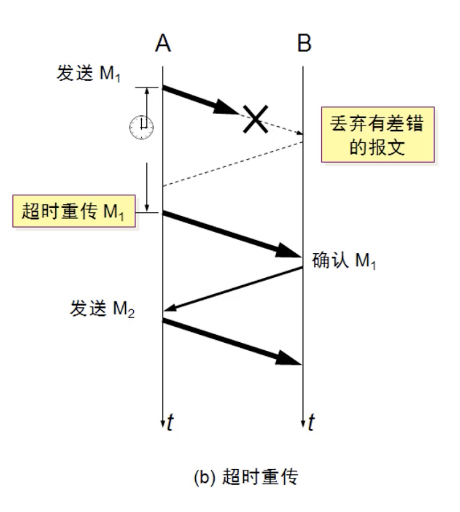

# iOS 网络分层及网络协议完全学习指南

> **维护说明（2026-10-20）**：本文是网络与安全的唯一复习入口。已基于旧稿进行准确性修订，并补入 iOS 网络层、弱网、Pinning 与工程安全内容。为保留学习轨迹，下面列出关键勘误的“原文 → 修订后”对照；后续正文以修订后的结论为准。

## 重要勘误对照（原文 → 修订后）

| 主题 | 原文的风险表述 | 修订后应记住的结论 |
|---|---|---|
| TCP 三次握手 | “客户端再返回一个确认建立连接的请求” | 第三次是 `ACK`，不是新的 `SYN`：`SYN → SYN+ACK → ACK`。三次握手确认双方收发能力、同步初始序列号，并避免历史延迟 SYN 造成服务端幽灵连接。 |
| TCP 可靠性 | “TCP 可靠传输、不丢包” | TCP 在连接存活且应用正确处理错误的前提下，通过序号、ACK、校验和、重传、窗口等尽力提供可靠有序字节流；超时、RST、连接断开后仍可能导致业务失败，应用层需处理。 |
| 流量 / 拥塞控制 | 两者均笼统描述为“按网络情况控制” | 流量控制保护接收方缓冲区，接收端通告 `rwnd`；拥塞控制保护整个网络，发送端按丢包、重复 ACK、RTT 等信号调整 `cwnd`；实际窗口约为 `min(rwnd, cwnd)`。 |
| DNS / HTTPDNS | “HTTPDNS 后就不存在 DNS 解析问题” | HTTPDNS 仍是域名→IP 的解析，只是通过指定 HTTP/HTTPS 服务绕过 LocalDNS；需保留 TTL、系统 DNS 降级，并在 HTTPS IP 直连时正确处理 Host、SNI 和证书域名校验。 |
| HTTP 无状态 | “无状态、无连接；每次请求连接和断开” | 无状态是 HTTP 默认不保存跨请求业务会话；HTTP/1.1 可复用 TCP 持久连接。两者不矛盾。 |
| Keep-Alive / 多路复用 | 容易将连接复用等同于多路复用 | Keep-Alive 是多个请求复用 TCP 连接；HTTP/2 才通过 Stream 真正多路复用。 |
| Base64 / MD5 | “Base64 防明文”“MD5 用于完整性 / 密码” | Base64 只是可逆编码，完全不提供保密性；不要用 MD5 存储密码或作为安全完整性方案。密码应使用带盐、慢哈希（如 Argon2/bcrypt/PBKDF2）；传输完整性由 TLS AEAD / HMAC 等机制提供。 |
| HTTPS / TLS | “TLS 是 HTTP 的 S”“HTTP2 因 HTTPS 延迟很高” | HTTPS 是 HTTP over TLS；TLS 提供机密性、完整性、服务端身份认证。HTTP/2 规范并非强制 TLS（浏览器实践常要求），TLS 1.3 已显著降低握手 RTT。 |
| TLS 1.2 / 1.3 | 仅描述 RSA 预主密钥模型 | RSA 预主密钥是 TLS 1.2 的历史简化模型：客户端用服务端公钥加密 `Pre-Master Secret`，双方配合两个 Random 派生密钥。TLS 1.3 移除 RSA 密钥交换，使用临时 `(EC)DHE`，提供前向保密。 |
| QUIC | “QUIC 不存在三次握手” | QUIC 不使用 TCP 三次握手，但仍有基于 TLS 1.3 的连接建立；首次通常 1-RTT，恢复可 0-RTT（有重放风险，仅限幂等请求）。 |
| Socket / HTTP | “HTTP 是短连接、Socket 是长连接” | Socket 是编程 API，TCP/UDP 都可使用；连接长短取决于上层协议与连接管理。HTTP/1.1/2 可持久连接，WebSocket 是基于 TCP 的全双工应用层协议。 |
| iOS 签名 | “Xcode 对 APP 源码文件签名” | Code Signing 对构建产物中的代码目录、资源和 entitlements 等签名，不是对源码签名；Provisioning Profile 的设备列表主要适用于开发 / Ad Hoc，App Store 分发链路不同。 |

---


# 计算机之间的通讯基础

## IP地址 \& MAC地址

两台计算机之间想要相互通讯，需要知道对方的**IP地址**。然后如果要发数据到对方计算机，得把数据发送到对方网卡，由**网卡**将数据传递给上一层，所以还得知道对方的**网卡地址**，也就是**MAC地址**。具体的操作是：

- 将数据通过自己的网卡发送给对方的网卡：

    - 如果网卡发现数据的目标MAC地址是自己，就会将数据传递给上一层进行处理；

    - 如果网卡发现数据的目标MAC地址**不是**自己，就会将数据丢弃，不会传递给上一层进行处理；

- **MAC地址**：是由生产厂商设置的。当Mac地址是全F的，则说明是广播地址

- **IP地址**：每一台主机都有一个IP地址。IP地址由两部分组成：网络标识\(网络ID\)\+主机标识\(主机ID\)

    - 同一网段的计算机，网络标识相同；

    - 网络 ID = 子网掩码 \& IP地址 

### 那如何拿到目标地址的网卡地址呢？ 

- ARP广播，在不知道对方MAC地址的情况下，会通过ARP广播，如果发现是自身的IP地址，则就会把MAC地址返回回去。ARP广播会对所有的设备部发送广播。\(ARP广播通俗点就是给所有设备发送一条信息，询问：你是否知道这个IP地址的MAC地址是什么吗？\)

# 计算机连接方式

## 网线直连：

需要用交叉线直连；

## 同轴电缆：

半双工通信，容易冲突；

## 集线器：

半双工通信，容易冲突、不安全；当一台设备让某个Mac地址发送消息时，会对与之相连的所有设备都发送1次

## 网桥：

能够通过自学习得知每个接口那侧的MAC地址（缓存Mac在当前网桥的哪一侧）。从而起到隔绝冲突域的作用；

## 交换机：

相当于更多接口的网桥，全双工通信。（相当于交换机有很多接口，然后每个接口都能记录该接口对应那一端的所有设备的Mac地址。这样就不会像集线器一样给所有的设备发送信息，而不是给所有的连接设备发送信息。当然了第一次广播，肯定也是所有的设备都会发射一次）组件局域网肯定要使用交换机。

## 路由器：

- 网线直连、同轴电缆、集线器、网桥、交换机

    - 连接的设备必须在同一网段；

    - 连接的设备处在同一广播域；

    - 网段：通常我们看到的192\.16\.1\.10、 192\.16\.1\.11、192\.16\.1\.12。192\.16\.1就可以认为是同一个网段。同一网段就形成了同一广播域，也就是说ARP只会在这一区域发生广播。所以不同网段的设备是没法通过网线直连、同轴电缆、集线器、网桥、交换机这些方式进行通信的。

    - 路由器就是用于在不同网段中进行通信、转发数据的设备。起到隔绝广播域的作用。


IP地址1s：192\.16\.1\.10、 192\.16\.1\.11、192\.16\.1\.12

IP地址2s：192\.16\.2\.10、 192\.16\.2\.11、192\.16\.2\.12

- IP地址1s中的设备是无法直接与IP地址2s中的设备进行通信的。\(不在同一网段的设备无法收到ARP广播，也就是无法拿到MAC地址，也就无法进行通信\)

IP地址1s中的设备之间可以使用交换机进行通信\(这个可以理解为一个网段或广播域，ARP广播可以相互接收到\)

要想使IP地址1s中的设备与IP地址2s中的设备进行通信，则需要使用路由器。

IP地址1s的交换机 ———— 路由器 ———— IP地址2s的交换机

其次路由器也有多个对外接口，这个接口称为**网关**，**网关有自己的IP地址和MAC地址**。每个网关与对应的广播域是属于同一网段。这样当路由器的网关接收到一个通信信息时，就能够知道发给哪一个网关的IP地址了。\(网关也是有MAC地址的\)


所以当代的技术就是：**交换机\+路由器**。

路由器中的WAN口连接外网，LAN口连接内网。家用无线路由器里内置了交换机。

## 总结：

**交换机**连接的设备在同一个网段。同一个网段代表在同一广播域，所以任一设备发出的东西，同一网段（广播域）的所有设备都能够收到。 如果全球所有的设备都用交换机连接在一起，那么就会形成广播风暴——只要有任一设备发送信息，全球其他所有设备都能收到。所以我们通过**路由器**来隔离不同网段的设备。


## 互联网

- ISP : 因特网服务提供商。比如：移动、电信、联通。

- 局域网：局域网使用的网络技术叫以太网。

- 上网方式：

    - 电话线：使用调制解调器，将数字信号和模拟信号进行转换

    - 光纤：使用光调制解调器，将数字信号与光信号进行转换 

# 网络分层（重点）


## OSI  7层参考模型：

应用层、表示层、会话层、运输层、网络层、数据链路层、物理层；

## TCP/IP 5层协议模型：

### 应用层:

处理的数据是：**报文、用户数据**；

常用协议是：FTP、HTTP、SMTP、DNS、DHCP等；

### 运输层:

处理的数据是：段；

常用的协议是：TCP、UDP；

### 网络层：

处理的数据是：包；

常用的协议是：IP、ARP、ICMP；

### 数据链路层:

处理的数据是：帧；

常用的协议是：CSMA/CD、PPP；

### 物理层:

处理的数据是：比特流；

常用的协议是：无；

# 物理层

物理层定义了接口标准、线缆标准、传输速率、传输方式等；比如网线、路由。

## 信号

- 数字信号：适合短距离传输，稳定性高；

- 模拟信号：适合长距离传输，稳定性差；

## 数据通信模型

### 局域网通信模型

PC ——数据信号/网线—— 集线器或交换机 ——数据信号/网线—— PC

注意：网线不能超过100米

### 广域网通信模型

PC ——数据信号/网线—— 调制解调器 ———模拟信号/电话线——— 调制解调器 ——数据信号/网线—— PC

调制解调器就是对数字信号和模拟信号进行转换。

## 信道

### 信道：

信息传输的信道。一条传输介质\(比如网线\)上可以有多条信道。\(比如A到B，B到A就是两条信道\)

### 单工通信：

信号只能往一个方向传输。比如无线电广播，有线电视广播；

### 半双工通信：

信号可以双向传输，但是同一时间只能往一个方向传输。比如对讲机；

### 全双工通信：

信号可以同时双向传输。比如手机\(打电话，听说同时进行\)      

# 数据链路层

- 链路：从一个节点到相邻节点的一段物理线路\(有线或无线\)，中间没有任何交换节点。

- 数据链路：在一条链路上传输数据时，需要有对应的通信协议来控制数据的传输

    - 不同类型的数据链路，所用的通信协议可能是不同的。

        - 广播信道：CSMA/CD协议；\(比如同轴电缆、集线器等组成的网络\)

        - 点对点信道：PPP协议\(比如2个路由之间的通信\)

## 数据链路层的3个基本问题

### 封装成帧：

IP数据包\(网络层数据包\), 给其添加帧首部和帧尾部。

注意：每一种数据链路层协议都规定了所能够传输的帧的数据长度上限。\(比如以太网的最大长度为1500个字节\)。

### 透明传输：

是指在传输过程中会进行一些转义\(细节可以忽略\)。

### 差错检验：

数据链路层会\*\*将IP数据和数据链路层首部计算出一个FCS数据放在帧尾部\*\*。当传输到另一端的时候，接收端也会对IP数据包与数据链路层首部计算出一个值，然后将其与FCS进行比较来判断IP数据包是否有差错。

# 网络层

网络层数据包（也叫**IP数据包**）由首部、数据2部分组成。这里的数据是由传输层传递下来的数据段，然后首部字段至少占用20个字节\(大部分都是20字节\)，最长60个字节

网络层主要就是**IP协议**。

## 网络层包含的首部字段

- 版本：指 IPv4 or IPv6，占4位；

- 首部长度：表示首部实际长度，占4；

- 区分服务：用来提高网络的服务质量，占8位。\(区分服务如果有特殊字段，数据链路层可能会让其提前通过\)；

- 总长度：首部\+实际数据的总长度；

- 标识：当数据包过大时，就需要进行分片。这个标识就是用来表示哪些片是属于同一个数据包的，占16位；

- 标志：占3位，第一位不使用，第二位表示是否允许分片（如果设置了不允许分片，但是长度又超过了1500，则就会报错发不出去）；第三位表示是否是最后一片（因为每一片到底时机不一样，所以并不能确定是否都到达了）；

- 片偏移：分片数据的首字节相对于原始数据包中的字节偏移位置除以8，占13位；\(标识表示是同一个数据包，片偏移就能表示当前分片是处于数据包的哪个位置，除以8就怕13位不够使用\)。

- 协议：存储使用到的协议；\(比如从运输层传过来的，可能就有TCP或UDP。但是有的数据可能不是从运输层传过来的。像ICMP协议，直接就可以从网络层发送数据\)

- 首部校验和：用来差错检测，类似数据链路层的差错检测；

- 生存时间：主要是可以用来查询经过哪些路由器。

- 源IP：

- 目标IP：

## 分片

因为数据链路层的数据长度不能超过1500个字节。所以对于特别大的数据，就会将其进行分片。分片是在传输层进行的。

- 每一片都有自己的网络层首部\(IP首部\)


# 传输层

传输层有两个协议

- TCP 传输控制协议

- UDP 用户数据报协议

## TCP \& UDP


- 连接性： TCP 面向连接； UDP 无连接；

- 可靠性： TCP 通过确认、重传、序号等机制提供可靠、有序的字节流（应用仍需处理超时/断连）； UDP 不可靠传输,**尽最大努力交付**、可能丢包；

- 首部占用空间：TCP 大； UDP 小；

- 传输速率： TCP 慢； UDP 快；

- 资源消耗： TCP 大； UDP 小；

- 应用场景： TCP 浏览器、文件传输、邮件发送； UDP 音视频通话、直播；

- 应用层协议：TCP 常承载 HTTP/HTTPS、FTP、SMTP；DNS 通常使用 UDP，也可使用 TCP；QUIC/HTTP3 基于 UDP。

## UDP —— 用户数据报协议

- UDP 是无连接的，减少了建立和释放连接的开销

- UDP **尽最大努力交付，不保证可靠交付**

- 因为无需维护一些复杂的参数，所以首部就只需要8个字节。首部主要包括：

    - 源端口号

    - 目标端口号

    - UDP长度：首部长度\+数据长度

    - UDP检验和

        - UDP会在计算检验和的时候在首部和数据之外添加一个伪首部，这个伪首部包含源IP地址、目标IP地址、协议、UDP长度。然后UDP会使用伪首部、首部、数据计算出一个检验和。最后检验和再放到首部里，而不会往网络层传递

## TCP —— 传输控制协议

### 首部：


因为它要保证可靠传输，所以需要这么多数据进行处理。

TCP首部是由20个字节的固定长度和部分可变长度一起组成。首部长度在20\~60之间。

- 源端口：**（重要）** 

- 目标端口 ：**（重要）** 

- 序号：**（重要）** 

    - 建立链接后，序号代表本次传给对方的TCP数据部分的编号\(实际取的是数据部分第一个字节的编号，因为TCP需要保证按序到达，所以需要序号\)；

- 确认号：**（重要）**

    - 接收方表示确认收到前面的数据，所以叫做确认号。发送方知道确认号后，就会发送后续数据。

- 数据偏移：占4位。数据偏移的值 x 4 === 首部长度。\(这里和UDP不一样，它这个长度没有包含数据长度。那这个数据长度怎么计算呢？首先网络层也含有首部字段，接收端可以根据网络层首部的总长度计算出传输层数据的段总长度，然后减去偏移量，就是传输层数据长度。其实UDP也可以这样计算出来\)

- 保留：暂时全为0，应该是没有用上

- 标准位：**（重要）**

    - URG：紧急指针，为1表示当前报文有紧急数据，应尽快传送；

    - ACK：确认号，为1表示确认连接；

    - RST：重置，为1表示连接中出现差错，必须释放连接，然后重新建立连。这个经常用到，比如一直出现丢包，那么就说明发送了严重错误，就需要断开重连。

    - SYN：为1 表示建立连接的请求；

    - FIN：为1 表示要求释放连接；

- 窗口：**（重要）** 用于告诉对方下一次运行发送的数据大小；流量控制、拥塞避免都是根据这个来做文章。

- 检验和：和UDP是一样的，检验和 == 伪首部 \+ 首部 \+ 数据。这个伪首部包含源IP地址、目标IP地址、协议、UDP长度。然后UDP会使用伪首部、首部、数据计算出一个检验和。最后检验和再放到首部里，而不会往网络层传递

- 紧急指针

- 可变选项

- 填充

### 建立连接

#### 三次握手：

客户端给服务器发送一个建立连接请求：**SYN = 1， ACK = 0**，seq = x；\(seq 表示客户端初始序号\)

服务器接收到建立连接请求后，会返回一个确认报文，并携带一个建立连接的请求：**SYN = 1，ACK = 1**，seq = y, ack = x \+ 1；\(seq 表示服务器初始序号，确认号就是客户端序号 \+ 1\)

客户端收到后会返回一个确认建立连接的请求；**SYN = 0， ACK = 1**，seq = x \+ 1， ack  = y \+ 1；

> 服务器一开始肯定是占用了某一个端口，在监听状态。
> 
> 双方会交换一些信息。比如是否支持SACK、MSS\(最大\)、窗口缩放系数等
> 
> 

##### 为什么要三次，两次不行吗？

假如客户端发送建立连接的请求报文发生了超时，客户端会启用超时重传策略，重新发送连接请求，Server端收到了会回复确认报文，那之后又收到了之前超时的请求连接，，服务器又会返回确认连接的报文。如果没有第三次握手，那么这样就会又建立一次连接，相当于建立了两次连接。而多了那次客户端确认报文的话，服务器发送第二次确认报文后，客户端不会返回第三次握手，那么后面那次连接就建立不起来。

总之，是为了确保只有一次有效的双向连接。

#### 如果第三次握手失败了，会发生什么？

第二次握手后，此时服务器的状态为等待确认状态。若等不到客户端发出的第三次握手，服务器就会重新发送SYN\+ACK包\(第二次握手\)，如果多次重发SYN\+ACK后都等不到客户端的确认，就会发送RST包，强制关闭连接。

### 四次挥手：

三次握手建立连接之后，客户端和服务器就可以发送和接收数据了。数据收发完毕之后，就会断开连接。

1. 首先客户端发送一个FIN关闭连接的报文，

2. 服务器接收到后，就返回一个ACK的确认报文。

> 这样客户端往服务器的方向就关闭了。
> 
> 因为TCP是全双工连接，一旦建立连接。客户端可以往服务器发送数据，服务器也可以往客户端发送数据。所以关闭就得双方向都关闭。
> 
> 

3. 服务器也得发送一个FIN的关闭连接的报文。

4. 客户端接收到后，就会返回一个ACK确认报文。

> 这样服务器往客户端的方向才能关闭。
> 
> 有时候我们也会看到只有3次挥手的情况。其实就是第2次和第3次挥手合并了。出现这种情况的前提就是当服务器收到FIN时，发现自身也没有数据要发给客户端了。这个报文既包含第2次的ACK，也包含第3次的FIN报文。
> 
> 

### **可靠传输**：

可靠传输使用的是ARQ**停止等待协议**。是指每发送一个数据包就停止发送，等待确认。以及超时重传的策略。

#### 无差错情况：


在无差错情况下，发送方每发送一次数据，接收方收到后，会立即返回一个确认报文。发送方收到确认报文后，才会继续发送下一个报文。

#### 超时重传



当发送方发送完数据包之后，**数据丢包了**，接收方没有收到数据段。那么发送方在**超时时间**到达时没有收到确认报文，则会**重新发送刚才的数据段。**

#### “确认”丢失


当发送方发送完数据段之后，如果接收方接收到了数据。此时接收方返回一个确认报文，但是返回的**确认报文丢失了**，那么发送方同样会在超时时间到达时重新发送数据, 接收方收到后**会将重复的数据丢弃**，再返回确认。

#### “确认”迟到


当发送方发送完数据段之后，如果接收方接收到数据了。此时接收方返回一个确认报文，但是**返回的确认报文迟迟未收到**，那么发送方同样会在超时时间到达时重新发送数据，但是隔了**很久后**迟到的**确认报文又被发送方收到了**，此时发送方就什么也不会做。


> 问题：这样的发送效率会非常低。因为每一次发送都得等待前面的数据确认收到后才能发送下一个数据包。
> 
> 

#### 【重要\-最终】连续ARQ停止等待协议 \+ 滑动窗口协议


##### 滑动窗口

就是发送端有一个**发送窗口**用于连续发送数据包，接收端有一个**接收窗口**用于接收数据包。当发送窗口中的数据包连续发送完成后，就会停止发送，等待确认。当接收窗口接收到所有数据包之后，就会返回**一个**确认报文，返回的确认报文包含确认序号\(期望收到的下一个数据包的序号\)。发送方接收到确认报文后，就会滑动当前窗口，接着发送下一组数据。另外发送方有一个发送缓存，接收方有一个接收缓存。

- eg: 发送端增加一个发送窗口。假设发送窗口里有**4个**连续的数据包，发送端在将4个连续的发送闭包发送完成之后，停止发送，等待确认。接收端在接收到最后一个数据包后，会返回**1个**确认报文。发送端收到确认后，就接着发送其他的数据段。

##### 具体过程：


- 首先，建立TCP连接\(3次握手\)时，接收端会告诉发送端，当前接收**窗口的大小**，以便滑动窗口大小调整。（后续每一次确认报文，都会带上滑动窗口大小，所以窗口大小是一个动态的数值）

- 其次发送方需要为将要发送的数据配置一个**发送缓存**，然后根据窗口大小配置一个**发送窗口**。接收方也要为将要接收的数据配置一个**接收缓存**，根据窗口大小配置一个**接收窗口**。

- 然后发送方根据滑动窗口的大小，将需要发送的数据从发送窗口里**连续发**送出去。发送完成后，停止发送，等待确认。

- 接收方接收到数据后，会返回一个确认报文，这个确认报文还附带一个确认序号（下一个期望收到的数据包序号）。其次接收缓存会将已收到的连续数据传输给应用层，然后接收缓存会将已发送给应用层的数据删掉。

- 发送方接收到确认报文后，将窗口位置和大小进行调整，然后删掉发送缓存里已发送的数据，然后接着发送下一批数据包。

- 那如果发送数据段中出现了**丢包**的情况。假设序号为5、6、7、8，丢失了序号为7的包。那么接收方在接收完后，首先会将滑动窗口移动到7的位置。然后返回确认报文，确认报文里的确认号就是7（从丢失的包的位置重新发送）。

- 发送端接收到确认报文后，就会将发送窗口滑动到7的位置，然后重新开始发送连续数据包。但是这里要注意一点，因为数据段8已结被接收到了，所以发送端不会再将数据段8再发送出去（这种技术叫做**SACK选择性确认**，就不会重复发送已结发送成功的数据段，只发送已丢失的数据段。而实现这个技术的关键就是根据首部字段的**可变选项**，它会包含已经接收的数据段编号和未接收到的数据段编号）。


#### 补充问题

- Q：1、如果一个包连续N次都重传失败了，会无限重传吗？

应该不会，正常超过5次，就会被认为是连接中出现了严重错误，就会释放连接，重新建立连接。

- Q：2、滑动窗口的大小是固定的，那如果发送方的数据，不足滑动窗口大小，那接收方会一直等待下去吗？

不会，比如窗口是3，但是只有2个数据包发过来，那么接受端在接收到2个数据包后，会**等待一定时间**，然后就返回一个确认报文。

- Q：3、为什么在传输层就将数据进行分片？而不是等到网络层进行分片？（网络层有1500字节的限制，按理说更多大小限制。

    因为网络层、数据链路层都没有可靠传输的功能。如果是在网络层分包，如果有丢失情况，就需要将整个数据包重传，如果是在传输层分包。出现丢包，就只需要重传那个小包。

### 流量控制：

- 假设：如果接收方的缓存区满了，发送方还在疯狂发送数据？会发生什么？

接收方只能把收到的数据段丢掉。这样就会造成网络资源浪费；

所谓流量控制就是：**让发送方的发送速率不要太快，让接收方来得及接收处理。这是一个点对点的控制。**

流量控制也是通过滑动窗口协议做的。滑动窗口的大小不是固定的，是动态调整的。它是通过确认报文首部的窗口字段来控制发送速率的。发送方的发送窗口不能超过接收方给出的窗口大小。

当发送方收到接收窗口的大小为0时，那么就会停止发送。以此同时，发送方会主动开启一个定时器，隔一段时间发送一个测试报文去询问接收方最新的窗口大小。如果测试报文接收到的确认信息窗口大小还是0，则会再次刷新定时器。

### 拥塞控制：


拥塞控制就是为了防止过多的数据注入到网络中，防止网络中的路由器或链路过载。

发送方除了有一个发送窗口，还有一个**拥塞窗口**。如果网络比较拥塞时，那么拥塞窗口就会比较小。发送窗口除了跟接收端的接收窗口有关，也跟拥塞窗口有关。具体来说：

**发送窗口****大小 == min\(****拥塞窗口****大小，****接收窗口****大小\)**。

与流量控制不同的是，这是一个全网的控制。是通过**丢包**的情况来判断拥塞情况的。

#### 慢开始

确定了发送窗口大小，比如是3000，但是它发送并不是从3000直接开始，而是从很小的包开始。比如**一个**数据包，后面2个，再4、6等成倍增长，一直到达3000这个阈值。

#### 拥塞避免


就是在**慢开始**到达阈值后，就开始以**线性方式增长**，放慢增长速度，避免过早出现拥塞。只要出现网络拥塞，**把阈值减半**，与此同时，再开始执行慢开始。

> 如何知道是否发送网络拥塞？
> 
> 通过丢包来判断是否出现了拥塞。
> 
> 

#### 快速重传


接收方在收到一个失序的数据段后，就立即发出**重复确认**。比如接收方接收到了数据段1、数据段2、数据段4，那么它就发现数据段3没有接收到，所以就会**连续**发送**3个确认**收到数据段2（确认报文里就有想要收到数据段3的确认号），发送方收到重复确认后，就知道数据段3没有发送成功，所以就会立马再次发送数据段3，就不会等待超时重传了。

> 如果没有块重传到话，发送端实际是在一定时间阈值后，没有收到确认报文，才会重新发起重传。快重传就能缩短这个等待时间。
> 
> 

#### 快速恢复


如果发生了拥塞的话，可能会收到大量的**连续相同的确认**报文，也就是出现了丢包（快重传的预兆）。

快恢复就是在达到拥塞后，阈值会降低一半，降低后，就不再执行慢开始，而是继续执行新的线性增长。


**总结**：现在出现拥塞控制，就是通过**快速恢复**。

### TCP 疑问

- 若有一个包重传了N次还是失败，会一直持续重传到成功为止吗？

这个取决于系统设置。比如有些系统，重传5次未成功就会发送reset报文（RST 为1），断开连接。

- 如果接收窗口最多接收4个数据包，但是发送方只发了2个数据包，那么接收方如何确定后面还有没有2个包。

接收方接收到那个2个数据包后，会等待一定的时间后，如果没有收到其他的包，就会返回确认报文。

- 为什么选择在传输层进行分段，而不是在网络层再分片？

因为可靠传输是在传输层进行控制的。如果没有分片，一旦出现数据丢失，那么就得将整个数据重传。

# 应用层

## DNS

### DNS解析过程？

DNS服务器是提供域名到IP之间的解析服务，一般计算机就是一个IP地址，但是纯数字不符合人类的记忆习惯，所以一般会有一个域名，比如www\.baidu\.com ，当我们代码对某个域名发起访问的时候，则要通过DNS解析，找到对应的IP，然后再进行访问 。一般DNS解析都是有运营商进行管理，比如移动的卡发出来的访问，先经过移动运营商，然后移动运营商找到对应的ip，然后进行访问。

传统 DNS 查询通常使用 UDP/53，必要时（如响应过大、区域传送等）也会使用 TCP/53；传统 DNS 常为明文，DoH/DoT、DNSSEC 等可改善不同维度的安全问题。

### DNS解析查询方式：


1、递归查询：客户端将“拿到最终结果”的责任交给本地递归 DNS；递归 DNS 代替客户端完成后续查询。
2、迭代查询：递归 DNS 向根、顶级域、权威 DNS 逐级询问；上游通常返回下一步应查询的 DNS 服务器引用，直到拿到最终记录。

实际解析优先检查 App / 系统 / 本地递归 DNS 缓存，命中后按 TTL 直接返回。


### DNS劫持问题？


因为DNS是UDP明文传输，就有可能被钓鱼DNS劫持，返回错误的IP地址。
DNS劫持与解析都与http无关，它是发生在http之前的操作。
解决DNS劫持：
1、httpDNS：实际上DNS解析是指DNS协议向DNS服务器的53端口进行请求，HTTPDNS 是向指定的解析服务通过 HTTP/HTTPS 获取域名对应的 IP，绕过 LocalDNS 的传统 UDP/53 解析链路；它仍然是 DNS 解析，不能消除所有解析、缓存、调度或安全问题。比如：[http://119\.29\.29\.29/d?dn=www\.baidu\.com\&ip=163\.177\.153\.109](http://119.29.29.29/d?dn=www.baidu.com&ip=163.177.153.109) \(其中[http://119\.29\.29\.29/d](http://119.29.29.29/d) 是国内最大的DNS域名服务器，dn=www\.baidu\.com 是需要解析的域名，后面是本地IP地址\)
2、长连接：
客户端采用 长连server 从API Server通过内网专线获取IP的方式


### DNS解析转发问题？


是指DNS解析服务器为了节省资源，将解析请求发送给其他DNS域名服务器，依次转发，最后返回的IP地址可能不是同一运营商的网络，存在跨网访问的可能，造成一些请求缓慢等效率问题。

- 最新的DNS技术有一个叫做DNSSEC（DNS安全扩展）的东西。

- 简述：DNSSEC通过一个密钥对DNS数据进行签名。然后公钥会被公开发布。所以如果DNS被篡改了的话，使用公钥解密出来的东西就会跟原始数据不一样，DNS服务器就不会返回数据给用户。

由于IP地址不方便记忆。所以就使用域名来对应IP地址。不过在真实的网络请求过程中，肯定还是直接使用IP地址，因为要在路由器中进行传输，肯定得知道目前IP地址。

DNS就是将域名解析成对应的IP地址。DNS是可以缓存的（可以使用命令行查看、清空缓存的DNS）。

## DHCP

- IP地址可以分为静态IP和动态IP地址。

比如台式电脑可以使用静态地址，服务器也可以使用静态IP地址。

动态IP地址则就是从DHCP服务器获取的，比如移动设备、无线设备等。

- DHCP协议使用的是UDP协议，客户端使用68端口，服务器是67端口。

- 当设备从DHCP服务器请求IP地址时，DHCP会从IP地址池中，挑选一个IP地址“出租”给客户端一段时间，时间到期就回收它们。

### 具体过程

- 查找服务器

客户端 发广播包（源IP：0\.0\.0\.0，目标IP：255\.255\.255\.255，目标MAC：FF\.FF\.FF\.FF）

- 提供租约

服务器 返回可以租用的IP地址，以及租用期限、子网掩码、网关、DNS等信息。

- 选择IP地址

客户端 选择一个IP地址，发送广播包进行回应

- 确认

被选中的服务器发送ACK数据包给客户端

## HTTP

**HTTP 超文本传输协议**。（因为最初的HTTP协议就是为了发布和接收HTML页面，HTML是超文本标记语言，所以HTTP就被命名为超文本传输协议，不过到了现在，HTTP已应用特别广泛，不在仅限于HTML了）

- 历史版本

    - （1991）HTTP / 0\.9 :  只支持GET请求获取文本数据，且不支持请求头、响应头等。

    - （1996）HTTP / 1\.0 ：支持POST、HEAD等请求方法，支持请求头、响应头等，支持更多数据类型；浏览器的每次请求都需要与服务器建立一个TCP连接，请求处理完成后立即断开TCP连接。

    - （1997）HTTP / 1\.1：支持PUT、DELETE等请求方法；采用持久连接（connection：keep\-alive），多个请求可以共用一个TCP连接；

    - （2015）HTTP / 2\.0：

### HTTP报文

（无状态、无连接）

#### 请求报文

- 请求行：

    方法（Get、POST、 Delete）、 URL       HTTP版本

- 请求头：

    - HOST：服务器域名\+端口号        。xxx:8080        

    - Connection：keep\-alive （长链接）

    - Cache\-Control：用来指定在这次请求/响应链中的所有缓存机制。Cache\-Control：no\-cache

    - User\-Agent：浏览器的身份标识字符串。User\-Agent: XX/3\.3\.0 \(iPhone iOS13\.4\)

    - Accept：客户端能够接受的响应内容的类型

    - Accept\-Charset：客户端能够接受的字符集

    - Accept\-Encoding：客户端能够接受的编码方式列表

    - Accept\-Language：客户端能够接受的响应内容的自然语言列表

    - Cookie：之前由服务器Set\-Cookier发送的Cookie。Cookie：$Version=1;Skin=new;

    - Date：发送该消息的日期和时间

    - Content\-Type：请求体类型。Content\-Type：multipart/form\-data

    - Content\-Length：请求体长度。Content\-Length：348

    - Referer：表示浏览器访问的前一个页面，正是从该页面跳转进了当前页面

    - Range：仅请求某个实体的一部分，适用于断点下载。Range：bytes=500\-999

    - Origin：发起一个针对跨域资源共享的请求。与响应头里的Access\-Control\-Allow\-Origin成对。Origin：https://www\.baidu\.com

    - Connection：浏览器想要优先使用的连接类型。Connection：keep\-alive


- 请求体（一般post请求的参数放在请求体，get请求参数使用？\&拼在URL后面，而且URL的长度有一定限制）：

#### 响应报文

- 状态行：

HTTP版本        状态码        短语        

- 首部行：

    - Content\-Length：响应体长度。Content\-Length：348

    - Connection：连接方式，比如长连接。Connection：close

    - Date：发送该消息的日期和时间

    - Last\-Modified：所请求的对象的最后修改日期

    - Server：服务器名字

    - Expires：指定一个时间，超过该时间则认为响应过期

    - Content\-Type：响应体类型。Content\-Type：text/html；charset=utf\-8

    - Content\-Encoding：内容所使用的编码类型。Content\-Encoding：gzip

    - Content\-Disposition：一个可以让客户端下载文件并建议文件名的头部

    - Accept\-Ranges：服务器支持哪些种类的部分内容范围

    - Content\-Range：这部分消失属于完整消息的哪部分

    - Access\-Control\-Allow\-Origin：指定哪些网络可以参与到跨域资源共享过程中。Access\-Control\-Allow\-Origin

    - Location：用来进行重定向，或者在创建某个新资源时使用。Location：http://www\.w3\.org

    - Set\-Cookier：返回一个Cookie让客户端去保存。Set\-Cookier：UserID=xxx

    - Cache\-Control：向从服务器到客户端在内的所有缓存机制告知，它们是否可以缓存这个对象，单位为秒。Cache\-Control：max\-age=3600

- 实体主体

- URL 编码

URL中一旦出现了特殊字符，比如中文、空格，就需要编码

浏览器地址输入栏输入的URL，采用的是UTF\-8编码

#### 请求方法

- GET：一般用于读取操作；请求参数直接拼接在URL后面（但是浏览器对URL长度有限制）

- HEAD：请求得到与GET请求相同的响应，但是没有响应体。

场景：在下载大文件前，可以先发送一个HEAD请求，获取文件大小，再决定是否下载，以此来节约带宽资源。

- POST：常用于添加、修改、删除操作，请求参数放到请求体中（没有大小限制）

- PUT：对已存在的资源进行整体覆盖。（不安全，不常用）

- PATCH：用于对资源进行部分修改（资源不存在，会创建新的资源）

- DELETE：删除指定资源

- CONNECT：可以开启一个客户端与所请求资源之间的双向沟通的通道，它可以用来创建隧道

可以用来访问采用了SSL协议的站点。

- OPTIONS：用于获取目的资源所支持的通信方法，比如服务器支持的请求方法：$ OPTINS \* HTTP/1\.1

- TRACE：用于HTTP请求的测试或诊断

#### Get和Post的区别：

Get请求的参数通过？拼接在URL后面，post则放在Body里面。然后Get是**安全的、幂等的、可缓存的**，Post是**非安全的、非幂等的、非可缓存的**。安全性是指是否会引起server端的变化，幂等是指一种请求方法执行多次的结果是否完全相同，可缓存的是指代理服务器是否会进行缓存。

#### 状态码

- 信息响应：100\~199

- 成功响应：200\~299

- 重定向：300\~399

    - 302：重定向。一般重定向的位置会通过head的location返回一个新的服务器地址。（如果使用前后端分离的话，一般重定向由客户端决定，服务器不会返回重定向相关内容）

    - 304：可以使用缓存的内容，不返回内容。（主要是通过服务器来判断，比如连续两次请求，第二次服务器发现这次请求的内容一直没变过，且请求头里有说明有缓存策略。所以就不再返回内容，而是使用304）

- 客户端错误：400\~499

    - 400：服务器无法解析请求，说明语法错误

    - 401：由于缺乏目标资源要求的身份验证凭证

    - 403：服务器有能力处理该请求，但是拒绝授权访问

    - 404：服务器无法找到所请求资源

    - 405：服务器禁止了使用当前请求方式

    - 406：服务器无法提供客户端想要的Accept方式的响应

- 服务器错误：500\~599

    - 500： 服务器遇到意外强行终止

    - 501：服务器本身不支持请求方法。但是规定所有服务器必须支持Get和HEAD请求

    - 502：作为网关或代理角色的服务器，从上游服务器中接收到的响应是无效的

    - 503：服务器尚未处于可以接受请求的状态。一般是因为服务器停机了。


#### 跨域

- 前后端分离：一般来说前端代码需要部署到服务器中，如果前端代码和服务器代码是部署在不同服务器，就叫做前后端分离。

- 同源策略：浏览器有个同源策略。默认情况下，AJAX请求（异步请求的一种）只能发生给同源的URL（\*\*同源是指协议、域名、端口相同\*\*）（并不是所有的对象都得同源，只有部分请求需要遵循同源策略）。

- 所以很多浏览器请求页面数据都会面临页面和数据不同源的情况（比如服务器的端口号是8080，前端代码是在6464端口，那么就会受到跨域的影响）。

- 所以要解决跨域问题，就是服务器要在响应头里返回相关的支持字段，比如Access\-Control\-Allow\-Origin。告知浏览器一个允许跨域访问的请求。

- 跨域的策略只是服务器用来限制某些域名才能够访问的安全机制。但是并不是所有的对象都受同源策略的影响。

#### Cookie\&Session：**HTTP无状态**

**HTTP无状态：无状态，同一个用户在多次发送http请求时，server端并不知道是同一个用户发送的**

- 当客户端登录成功后，服务器会创建一个**Session对象**，Session对象包含一个id（比如666），也可能会存储登录信息。

- 然后服务器在**响应头**里的Set\-Cookier字段会返回一些信息，比如:SessionId（对应着刚才登录时Session对象的ID）、domain、path等。

- 客户端拿到Set\-Cookier的响应头后，就会将这个**Cookie**存储起来。下一次客户端请求的时候，如果发现path、domain和Cookie里面的一样，那么就会自动带上这个Cookie。

- 所以使用了Session和Cookie，那么就能够解决**HTTP无状态**的问题。

#### 持久连接：http的特点：无连接

**HTTP 无状态**表示协议默认不保存跨请求的业务会话上下文；它不等于每次都建立/断开 TCP。HTTP/1.1 默认支持持久连接，可复用 TCP 连接。

持久连接：应对http无连接特点。指在一定时间范围内不需要反复进行握手和挥手动作。http提供的持久连接的方案就是修改请求头部字段：

- connection: keep\-alive\(客户端期许采用持久连接\)

- time:20\(持久连接时间\)

- max：10\(这条连接最多可以发生多少次请求和响应对\)。

那怎么判断持久连接中的一次连接已结束呢？

- 通过响应头部字段：content\-length:1024来判断。

- 还有就是最后一个报文的chunked字段是否为空来判断。

## 网络安全

网络通信中，存在4种安全威胁

- 截获 （被动）：窃听通信内容

- 中断 （主动）：中断网络通信

- 篡改 （主动）：篡改通信内容

- 伪造 （主动）：伪造通信内容

### HTTP安全问题


HTTP协议默认**采用明文传输**，因此有很大的安全隐患

- 对通信内容进行加密，再进行传输。

### 加密解密

主要是为了解决数据安全的问题。比如使用POST请求，因为POST请求数据放在body里面相对get直接将参数暴露在外部更安全一些，其次使用HTTPS，对接口进行加密。

#### 数据安全基本原则：

- 在网络上不允许传输用户隐私数据的明文；

- 在本地不允许保存用户隐私数据明文；

### 常用加密方法

#### 编码方案：Base64:

Base64 只是二进制到文本的可逆编码，不是加密，不能解决明文传输或保密问题；任何人都可解码。传输机密性应依赖 TLS。

可以将任意二进制数据进行Base64编码，所有的数据都能被编码为只用65个字符A\~Z a\~z 0\~9 \+ / =）就能表示的文本文件；

#### 单向散函数：MD5、SHA等

单向散列函数，可以将任意长度的消息，计算出**固定长度**的散列值。它是一种摘要算法。

这种也是只能加密，不能解密。不能算真正的加解密方案。但是可以通过它来**防止数据是否被篡改**。

但是单向散列的方式是不可逆的。

散列函数常用于完整性校验、签名等；密码存储不能使用 MD5/SHA 的快速裸哈希，应该使用带盐、慢哈希/KDF（如 Argon2、bcrypt、PBKDF2）。假设没有存储加密后的值，那一旦数据库被破解，所有密码都会被泄露。又因为它是不可逆的，所以现在大多数忘记密码。都是只能重置密码，而无法找回密码。

特点：

- 根据任意长度的消息，计算固定长度的散列值；

- 计算速度快，能快速计算出散列值；

- 内容不同，散列值也不同，防止数据被篡改；

- 单向性，指计算出散列值后，无法推敲出原来的值；

##### 应用

- 防止数据被篡改
假设一份很重要的文件存储在电脑中，如果不加密，那么如果文件系统被黑客黑了，那文件内容就有可能被串改，而如果使用单向散列函数，每次查看的时候对比一下散列值，就可以知道文件是否有被篡改过。

- 口令密码的加密。
比如密码，一般用单向散列函数做一下摘要，避免明文传输和明文存储。假如被中间人攻击了，或者数据库被攻破了，那账号密码就不容易被泄漏了。所以忘记了密码通常也无法找回，只能重新设置。

总结：

- 单向散列用于生成固定长度摘要，以检测内容变化或参与签名；它不是为了“减少内容大小”，也不能提供机密性。

#### 对称加密


对称加密的特点就是加密/解密使用相同的密钥；加密和解密的过程是可逆的；加密的过程是先加密再base64编码，解密的过程是先base64解码再解密

常见对称加密算法

- DES、2DES、3DES：数据加密标准

- AES：高级加密标准

    - DES
    DES是一种将64位明文加密成64位密文的对称加密算法，密钥长度是56位。
    由于DES每次只能加密64位的数据，遇到比较大的数据，需要DES加密进行迭代。
    目前已经可以在短时间内被破解，所以不建议使用。

    - 3DES
    3DES就是将DES重复3次所得到的一种加密算法。过程就是通过3个密钥加解密，3个密钥都是不同的，加密过程：明文——加密——解密——加密——密文；解密过程：密文——解密——加密——解密——明文。
    3DES的处理速度不是很高，安全性也不是很高。

    - AES
    AES是取代DES、3DES的首选对称加密算法。目前无法被破解。目前对称加密算法最主要就是使用AES。

##### 密钥配送问题


因为加解密使用的是同一套密钥，那密钥配送就会产生问题。

#### 非对称加密


非对称加密的特点：使用公钥加密，使用私钥解密。公钥是公开的，私钥是保密的。

但是**非对称加密加解密速度慢、性能消耗较大**。

非对称加密算法：

- RSA

#### 混合密码系统

- 对称加密特点

    - 加解密使用同一个密钥

    - 无法解决密钥配送问题

    - 加密速度快

- 非对称加密特点

    - 加解密使用不同密钥

    - 加解密速度比较慢

    - 不存在密钥配送问题


上面说到，对称加密的缺点：不能很好解决密钥配送问题；非对称加密的缺点：加解密速度比较慢，性能消耗大。

**混合密码系统就是将对称加密和非对称加密的优势结合起来。既解决了非对称加密速度慢的问题，又通过非对称加密解决了对称加密的密钥配送问题。**


#### 数字签名

如何确认一条消息的真实性？比如被篡改、伪装、否认

数字签名就可以解决这个问题

消息的发送者用私钥签名，接收者用公钥验签（与非对称加密相反），这就是数字签名。通常用于身份认证。证书就是经由CA机构数字签名之后的公钥证书，用于身份认证。

- 数字签名虽然和非对称加密差不多，但是实际上它不是用来做加密的，而是主要**验证数据的可靠性**。

- 数字签名的公私钥是由发送端生成的。


[RSA 加密与验签](https://bhhbdrz3p9.feishu.cn/docx/KrngdDUSioxg6hxmmKVcne2snVd)

##### 非对称加密与数字签名总结：

非对称加密和数字签名是两个正好相反的过程。非对称加密，公私钥由接收者生成，发送者使用公钥进行加密，接收者使用私钥进行解密；数字签名时，公私钥由发送者生成，发送者使用私钥进行加密，接收者使用公钥进行解密。

理解：既然是加密，那肯定是希望只有自己才能解密。所以公钥负责加密，私钥负责解密。如果是签名，那肯定是不希望有人篡改我发送的消息，所以由私钥负责签名，公钥负责验签。

##### 数字签名无法解决的问题

- 数字签名不能保证消息的机密性
数字签名的作用不是为了保证消息机密性。而是为了鉴别元素消息是否有被篡改，而不是确保消息的机密性。

- 公钥的合法性没法保证：
数字签名必须保证接收者的公钥必须是真正属于发送者的。如果发生中间人攻击，公钥也可以被篡改、伪造，导致数字签名失效。

- 中间人攻击
中间人攻击，就是中间人既承担了发送者的身份，也承担了接受者的身份。
具体步骤就是：

    - 发送者发送公钥给接收者的过程中，中间人拦截了公钥，将公钥替换成自己的公钥\(伪公钥\)发送给接收者，保留真实公钥；

    - 发送者发送未签名消息给接收者，中间人拦截了未签名消息，然后篡改消息，再发送给接收者，接收者接收到的就是篡改之后的消息；

    - 发送者发送已签名消息给接收者，中间人拦截了签名消息，用之前拦截的真实公钥解密，然后篡改消息，使用自己的私钥（伪私钥）再进行加密发送给接收者；

    - 接收者接收到消息后，同样可以使用之前收的公钥（伪公钥）进行解密，解密出来的也是篡改之后的消息。所以，这样消息真实性的验证就能够通过。中间人攻击就能奏效；

#### 证书 

##### 公钥合法性问题

如果遭遇了中间人攻击，公钥可能是伪造的，导致加密失败。


但是上面的问题是公钥容易被伪造。其实只要是公钥在互联网上传输，就容易出现中间人攻击。

证书就是**第三方机构CA**结合非对称加密与数字签名一起来对公钥进行安全传输的方式。


所有的证书（驾驶证、身份证、公钥证书）都有一个统一的性质，那就是由权威机构认证颁发的。

密码学的证书是指公钥证书。它里面有姓名、邮箱等个人信息以及公钥，并由CA施加数字签名（数字签名过程，先将个人信息做单向散列，然后CA使用私钥对散列值进行加密，生成数字签名。）。

- 证书的使用和验证步骤

    - 接收者生成一对公钥和私钥；

    - 接收者将公钥提交到CA认证机构，进行注册；（这个提交也许是本地的，不太会存在中间人攻击问题）；

    - CA认证机构得到公钥后，会使用CA自己的私钥对那个公钥进行签名，然后生成一本证书；

    - 此时CA的数据库里就存在一个证书，该证书就包含接收者的公钥和CA的数字签名；

    - 发送者要使用的时候，就去CA认证机构下载证书，首先进行一下证书的验证过程；

    - 认证过程：发送者使用CA的公钥（这个是公开的）来解密证书里的数字签名，如果解密通过了，那说明证书是没有被串改的，表示认证通过了。这样也就相当于验证了证书里的公钥是没有问题的；

    - 发送者使用证书里的公钥对消息进行加密 ，然后发送给接收者；

    - 接收者使用私钥进行解密；

总结：

- 利用CA权威机构来解决中间人攻击的问题。

- 证书就是为了加密公钥的，保证公钥不会被篡改

- 证书同时用到了非对称加密和数字签名两种技术。

#### iOS签名机制

用于保证安装到手机上的APP都是经过Apple允许的。

##### 签名流程图

Mac设备有一对Mac公钥、Mac私钥；

Apple自己有一对Apple公钥、Apple私钥，只是Apple的私钥存储在Apple后台，Apple公钥存储在iOS设备中。

###### iOS签名步骤：


- 1、生成ipa安装包时，Xcode使用 Mac私钥 对APP源码文件进行签名。所以ipa安装包包含：APP源码文件、签名（编号001）；

- 2、生成证书时，使用Apple私钥对Mac公钥进行签名。所以证书包含：Mac公钥、签名（编号002）；

- 3、生成mobileprovision时，再次使用Apple私钥对\(证书、devices、app id、entitlements\)进行签名。所以mobileprovision文件包含：证书、devices、app id、entitlements、签名\(编号003\)；

- 4、最终打出来的包，就包含：ipa安装包和mobileprovision文件。

- 5、在安装的过程中，首先会使用Apple公钥验证最外一层的签名\(编号003\)，验证通过后，就说明mobileprovision里的内容（证书、devices、app id、entitlements）是没有被篡改的；

- 6、mobileprovision里的内容没有问题的话，再使用Apple公钥对证书里的签名（编号002）进行验证，验证通过后，说明证书里的内容（Mac公钥）是没有被篡改的；

- 7、证书里的内容没有问题的话，就可以直接使用Mac公钥了，然后使用Mac公钥验证ipa包里的签名（编号001），验证通过后，说明ipa包是没有问题的；

- 8、三层签名都验证完成后，那就可以把APP源码文件安装起来了。

其实从这一整套逻辑可以看出，它最终只是为了验证**APP源码文件**没有被篡改。

问题：

1、为什么不直接使用“Mac私钥签名，Mac公钥验证”这个步骤？

不行，因为这样彻底脱离了Apple，而且这样就没法保证Mac公钥是合法的。所以生成证书的过程，也是为了验证Mac公钥是合法的。

2、为什么需要用Apple私钥进行第二次签名？

第二次签名主要是添加了devices、APPID、entitlements。devices是为了控制只能用于调试的设备，APPID是为了控制只用于当前APPID的APP，entitlements则是为了控制当前APP所拥有的权限，比如推送、IAP等。

3、为什么不直接第一步就使用Apple私钥对APP进行签名，用Apple公钥进行验证？

因为Apple私钥存在苹果服务器。这样的话，每一次运行都得先把APP传输到苹果服务器，效率就更低了。

签名步骤中，与我们实际操作的对应关系以及各文件的对应关系：

- 钥匙串访问——证书助理——从证书颁发机构请求证书：
这里会获取到一个CertificateSigningRequest\.certSigningRequest文件。这个文件就是Mac公钥；

- Apple官网 —— 添加Certificate证书——\(选择develop证书或distribute证书\)——提交CertificateSigningRequest\.certSigningRequest文件：
这里会生成一个\.cer文件：distribute证书生成ios\_distribution\.cer证书，develop证书生成ios\_development\.cer文件。
它就是利用Apple后台\(可以认为是一个CA权威认证机构\)的私钥对Mac公钥进行签名的过程。对应上诉步骤的第2步骤。

- Apple官网 —— 添加iOS Provisioning Profile文件——\(选择development或App Store\)——选择APP ID —— 选择deveces\(development才会需要选择\)——选择certificates—— 生成一个test \.mobileprovision文件：
这里就对应上述第3步骤。

总结

- 生成 \.certSigningRequest文件
这个文件是Mac公钥，在本地电脑钥匙串获取的。

- 添加生成 \.cer 文件
这个熟称证书文件。是利用Apple私钥，对Mac公钥进行了数字签名

- 获取 \.mobileprovision文件
这个熟称配置文件。是利用Apple私钥，对\[cer证书\+deveces\+AppID\+entitlements\]进行了数字签名

如果APP是从App Store下载安装的，就不需要 \.mobileprovision文件，因为App Store已经保证了安装渠道是没有问题的。所以从App Store上下载的安装包，只使用了Apple私钥直接进行签名，然后安装时直接使用Apple公钥验证签名后就可以安装了。

#### TLS协议

TLS协议就是HTTP协议中的‘S’。TLS协议可以对传输内容进行加密、进行身份验证、避免传输内容串改。TLS协议包括TLS握手协议和TLS记录协议。TLS握手协议使用到的加密手法包括：非对称加密、散列函数、数字签名技术；TLS记录协议使用了对称加密、散列函数等技术。


#### 通常的做法：

- 1、敏感数据传输默认使用 HTTPS/TLS，不将 Base64 当作加密；

- 2、完整性、身份认证优先依赖 TLS 的认证加密与服务端鉴权；不新设计 MD5 方案；

- 3、如有明确威胁模型，可使用数字签名、请求时间戳/nonce、防重放和服务端风控；

- 4、避免自定义“客户端 RSA 加密、服务端 DES/AES 返回”的私有协议，除非有严格密码学评审；

- 5、双向 TLS 仅适用于确有客户端证书管理能力的场景，不是所有 App 的默认方案；Pinning 也应支持证书轮换与紧急回退。

[ios常用加密手法](https://juejin.im/post/5d9f41f16fb9a04e1e7bb17b)

## HTTPS

HTTPS = HTTP \+ SSL/TLS

### TLS 1.2 RSA 与 TLS 1.3 `(EC)DHE`：必须分开记

#### TLS 1.2 的 RSA 密钥交换简化模型（历史模型）

```text
ClientHello：ClientRandom、支持套件
ServerHello + Certificate：ServerRandom、证书（内含 RSA 公钥）
客户端：验证证书链、域名、有效期等
客户端：生成 Pre-Master Secret（PMS）
客户端 → 服务端：使用服务端 RSA 公钥加密后的 PMS
服务端：使用长期 RSA 私钥解密 PMS
双方：PMS + ClientRandom + ServerRandom → 派生会话对称密钥
```

这里**只有服务端 RSA 公钥用于加密 PMS**；两个 Random 不直接参与“加密 PMS”，而是和 PMS 一起派生密钥。

#### TLS 1.3 的现代模型：不发送 Pre-Master Secret

TLS 1.3 移除了 RSA 密钥交换。它**不会生成、RSA 加密并发送 PMS**，也不是“双方公私钥拼成 PMS”。

```text
ClientHello：客户端临时 (EC)DHE 公钥 key_share
ServerHello：服务端临时 (EC)DHE 公钥 key_share
Certificate + CertificateVerify：服务端证书及其对握手 transcript 的签名
双方本地计算：自己的临时私钥 + 对方临时公钥 → 同一个 shared secret
双方：shared secret + handshake transcript 等 → 通过 HKDF 派生握手/应用流量密钥
```

临时私钥从不通过网络发送；网络上只交换临时公钥。服务端长期证书私钥主要用于**签名握手 transcript、证明服务端身份**，而不是解密客户端发送的 PMS。

#### 前向保密

```text
未来服务端长期证书私钥泄露
≠ 可以推导过去每次连接的临时私钥
≠ 可以从录制的临时公钥得到过去 shared secret
≠ 可以解密过去的会话流量
```

这就是前向保密。TLS 1.3 首次握手通常 1-RTT；会话恢复的 0-RTT 有重放风险，只应使用于幂等请求。

### HTTPS连接的建立流程

- 1、客户端先向server发送一个SSL版本及支持的加密算法和随机数C；

- 2、server会返回一个选定的加密算法、随机数S、server端证书。（证书包含域名、发行方、有效期、公钥、签名等信息）

- 3、客户端接收到后会先验证server证书，然后通过C、S、预组秘钥组装成会话秘钥；之后通过server端公钥对预组秘钥进行加密发送给server端；（验证过程就是通过证书里的相关信息推导出它的合法性）

- 4、server端则通过私钥解密预组秘钥，然后通过C、S、预组秘钥组装会话秘钥。然后向客户端发送一个Finished消息，表示TLS握手完成。

握手 RTT 与 TLS 版本、是否复用连接、会话恢复、网络条件有关，不能机械记为“7 次握手、5 个 RTT”。典型 TLS 1.2 首次握手需更多 RTT；TLS 1.3 通常可 1-RTT 建立，恢复场景可 0-RTT（但有重放风险）。HTTP/2 规范不强制 TLS，浏览器实践常要求 HTTPS；HTTP/3 使用 QUIC + TLS 1.3 进一步降低连接建立与 TCP HOL 影响。（下文再说）

更细节的TLS链接MJ版本：

1. 客户端向Server端，发送一个消息。消息体

2. Server端返回一个消息：

[HTTPS的7次握手和9倍延时](https://draveness.me/whys-the-design-https-latency/)

#### Q：HTTPS都使用了哪些加密手段？

混合加密：对称加密和非对称加密。非对称加密在公私钥中使用到，传输过程中则是使用对称加密。

#### Q：什么是非对称加密和对称加密？

非对称加密包含两个概念：公钥、私钥。加解密使用的钥匙不一样的。用公钥加密，就得用私钥解密；私钥加密就得用公钥解密。（RSA）

对称加密：加解密用的是同一个秘钥。（AES）

#### Q：HTTPS的验证证书怎么做的？

首先服务器返回的证书也是CA机构颁发的证书。所以证书里面会包含CA颁发机构、有效期、公钥、服务器域名、签名等信息。

验证过程：

客户端根据证书信息链，先确定证书是否为可信任证书，并且根据该证书查找到根证书信息，然后反向推导出当前CA证书的公钥等信息。拿到公钥等信息后与证书里的签名进行解密。然后与服务器返回的信息做比较，如果结果一致，那么就是合法的。

#### Q：如何使用Charles抓取Https协议，原理是什么？

首先Charles是根据中间人攻击的方式来抓取网络请求的。具体过程就是：Charles拦截客服端发往服务端的网络请求，然后再往服务端发送请求，服务端返回的响应数据，Charles也会再截取之后往客户端发送。一句话Charles就相当于同时干了server端和客户端的所有事情。而HTTPS又是怎么拦截呢？首先原理是一样的，其次HTTPS较HTTP多了一个TLS协议，要支持HTTPS协议的服务器也必须去CA申请一个证书，然后客户端校验通过后才会建立起连接通道，所以Charles想要拦截HTTPS协议，也必须先去CA申请一个证书（过程就是用手机浏览器访问charlesproxy\.com/getssl,安装好证书。然后Charles需要在SSL Proxying添加上APP的访问域名和端口号，注意端口号是443）。然后使用的过程中手机需要先去设置里信任证书。意思就是客户端安装的是Charles服务器的CA证书，Charles安装的是服务器的CA证书。

#### Q：怎么防止中间人攻击

- 方案1：进行网络请求的时候，判断是否设置了代理i，如果设置了代理，就不允许访问。

- 方案2：客户端本地做证书校验。主要是对域名进行校验。当然了，代价会很大，因为很多公司的域名包含子域名。所以要校验域名就得使用通配符域名。

- 方案3：使用证书。

#### Q：HTTPS是绝对安全的吗？为什么

不是，如果是用户主动运行证书使用，那么也是可以被中间人抓包的。

[HTTPS 抓包原理](http://www.javaobj.com/2020/05/https-security/)
[iOS如何防止HTTPS抓包](https://www.jianshu.com/p/4682aecf162d)

#### HTTP1\.x和HTTP2的主要区别

- HTTP2采用二进制**帧**格式，HTTP1是文本格式。二进制格式更健壮；

- HTTP2有**多路复用**，即共享连接，相当于每个连接上可能会有多个request；

- HTTP2的会进行**头部压缩缓存**。HTTP1则每次都会重复发送；

- HTTP2 可以控制流的**优先级和权重**

- 服务器推送：服务器可以对一个客户端请求发送多个响应

#### HTTP2的问题：

##### 对头阻塞

- 前面有丢包，会等待重发。实际是TCP协议的问题

##### 握手延迟

- 还是由于使用的TCP，所以会有握手时间

#### HTTP3

http3弃用TCP协议，改用基于UDP的QUIC协议

#### QUIC协议

我们知道使用TCP协议存在建立和释放连接。另外TCP的各种维持可靠性、按序到底等数据。所以协议使用势必会影响到一定的性能问题。

QUIC 基于 UDP 实现，不使用 TCP 三次握手，但仍需基于 TLS 1.3 建立安全连接。它在用户态实现可靠传输、拥塞控制、流多路复用与连接迁移；首次连接通常 1-RTT，恢复可 0-RTT。它只需要用户端和服务端的应用支持QUIC协议就可以实现

##### Http3:问题：

- 操作系统内核、CPU负载

- 

[QUIC协议](https://www.cnblogs.com/chenny7/p/11661962.html)

[QUIC协议原理分析](https://zhuanlan.zhihu.com/p/32553477)

## socket

socket是对TCP/IP协议的封装，它本身并不是协议，而是一套API，通过socket才能使用TCP/IP协议，它包含了：连接使用的协议、本地主机IP、本地进程协议端口、远程主机IP、远程主机协议端口等信息。

IP地址：用于区分哪一台机器需要建立连接；

端口号：用于区分哪一个应用需要建立连接；

socket通信报文一般分为报头和正文。报头一般包含：操作指令用于解开正文、正文长度、报文认证信息等。

### socket VS http：

- http
HTTP是超文本传输协议，建议在TCP协议之上的应用层协议。HTTP 是应用层请求/响应协议，是否长连接取决于 HTTP 版本、Connection 策略与服务端配置；HTTP/1.1/2/3 均可复用连接。HTTP 不能简单等同于短连接。

- socket
socket可以支持不同的传输层协议\(TCP、UDP\)，当使用TCP时，socket连接就是TCP连接。Socket 是操作系统提供的网络编程 API，可基于 TCP 或 UDP；是否长连接、是否双向持续通信由上层协议和应用连接管理决定。建立连接后客户端和服务端会一直连着，当有数据更新时，服务器会直接发送给客户端，不需要客户端主动请求。当然了，在连接过程中,长期不活跃的连接有可能被系统断掉，为了保证连接不断开，客户端也会定时不间断地发送心跳数据，如果连接断了，则需要自己手动重连。

- WebSocket

    - 是一个基于TCP的支持全双工通信的应用层协议。

    - WebSocket使用80、443端口，可以绕过大部分防火墙

    - WebSocket需要先建立连接。

        - 由客户端主动发出握手请求

### socket链接建立

建立Socket链接至少需要一对套接字，分别运行于服务端和客户端，步骤：

- 服务器监听
服务器开启，始终等待，实时监听客户端请求链接

- 客户端请求
客户端发出请求，指定服务端Socket的地址和端口号

- 链接确认
当服务器Socket监听到客户端Socket的链接请求时，做出响应。建立一个新的进程，把服务端Socket的描述发给客户端，该描述得到客户端确认后就可以建立起Socket链接。而服务端则继续监听其他请求。

### socket粘包和半包处理：

如果socket是TCP连接，则就可能涉及到粘包和半包问题。粘包就是多组数据被一并接收了，粘在一起，无法划分。半包就是数据不完整，无法处理。解决的方式：在socket通信报文的头部的信息中，会约定好一个字段专门用于描述数据包的长度，这样就使数据有了边界，依靠这个边界，粘包的数据就能划分出来，半包的数据也能知晓数据的缺失。

### socket Net打洞：

- 什么是NAT穿透技术？
NAT叫做网络地址转换，主要是将内部的私有IP转换成可以在公网使用的公网IP；

- 打洞流程：

- 1、客户端A、B分别发送消息给服务器S;

- 2、S转发A的IP\+port给B，同时也转发B的IP\+port给A，使得A、B都知道对方的IP\+port；

- 3、A直接发消息给B，此时B会屏蔽这条消息，但是也让A的NAT映射中加上了一条映射，允许接收来自B的消息。所以B——\>A打洞成功

- 4、B发消息给A，由于A能接收到这条消息，同时B的NAT映射上也添加了一条可以接收来自A的消息的映射。此时A——\>B打洞成功。

[swift socket实战](https://www.hangge.com/blog/cache/detail_756.html)

[最详细网络协议](https://blog.csdn.net/kyl282889543/article/details/99670768)


## 代理服务器


代理服务器可以看做是一个中介。

它本身不生成内容。只是转发上下游的请求和响应。

为什么要代理服务器？因为有可能我们可能连不上目标服务器。比如访问国外服务器，那么就需要借助代理服务器。为客户端提供服务的叫做正向代理，为服务器提供服务的叫做反向代理。

对于客户端：代理服务器可以隐藏客户端身份；绕过防火墙；访问控制；数据过滤等。

对于服务器：隐藏服务器身份；安全防护；负载均衡等。

- 抓包工具Charles的原理就是：在客户端启动了正向代理服务。

- 使用代理服务器的话，会在请求头和响应头设置一些相关信息，比如Via、X\-Real\-IP 客户端的真实IP地址。

## CDN


CDN 叫做内容分发网络。它利用最靠近每位用户的服务器，将更快更可靠的资源传递给用户。

CDN是由CDN运营商提供的，比如移动、联通等


## 其他

### 网卡

网卡在数据链路层；

网卡影响处理数据的速度

### 端口

#### 默认端口号

假设服务器要监听http的请求，就需要监听8080端口；如果要监听https的请求，就要监听443端口。


- 客户端的端口是临时开启的随机端口。一旦请求完成就会关掉。

- 服务器端口是固定不变的，常见的服务端默认端口：

    - HTTP        默认端口号：TCP \+ 80；

    - HTTPS    默认端口号：TCP \+ 443

    - FTP          默认端口：TCP \+ 21

    - MySQL   默认端口：TCP \+ 3306

    - DNS        默认端口：UDP\\TCP \+ 53

    - SMTP        默认端口：TCP \+ 25

    - POP3        默认端口：TCP \+ 110

- 防火墙可以通过设置开启、关闭某些端口来提高安全性。

### 怎么区分长连接和短链接？

通常来说连接建立成功后，只进行了一次数据交互就断开连接的连接就是短链接；如果建立连接后，会持续进行多次数据交互之后才释放的连接就是长连接。

### 多个客户端如何与服务端进行连接

每个客户端跟服务器之间的连接都是通过socket。每个客户端开始与服务器进行连接的时候都会生成一个socket对象。然后服务器有一个ServerSocket一直处于监听状态，一旦监听到客户端的请求，就会通过ServerSocket生成一个对应的socket。也就是说，有多少个客户端，服务器也会对应生成多少个socket。

# 其他

## 语言跨平台原理

### C/C\+\+：

C/C\+\+文件要实现跨平台，则需要编译成对应平台的可执行文件。比如说要在Windows上运行，需要编译成PE格式文件；要在Mac上运行，需要编译成Mach\-O格式文件；要在Linux上运行，需要编译成ELF格式文件。

相当于不同平台都得单独编译。

### Java

Java代码先编译成字节码文件。然后不同平台想要运行Java代码，需要安装JVM。JVM的作用就是将字节码文件翻译成机器指令。然后Java就可以在运行。

相当于一次编译，多次运行。


# iOS 网络层与安全工程实践（补充）

> 本章补入旧稿未覆盖或覆盖不足的 URLSession、HTTPDNS 接入、弱网治理、SSL Pinning 与客户端安全工程边界。

## URLSession / 网络层设计

```text
请求构建（URL、method、headers、body）
→ 鉴权（Token 注入、刷新与并发合并）
→ URLSessionTask
→ 序列化 / 错误映射
→ 缓存、请求去重
→ 超时、重试、取消
→ 指定队列 / 主线程回调 UI
→ 指标：DNS、建连、TLS、TTFB、下载、错误码、重试次数
```

- **取消**：`task.cancel()` 是协作式取消；completion 仍可能到达。页面或 Cell 更新 UI 前仍应校验请求身份和页面状态。
- **Token 刷新**：多个请求同时收到 401 时，不要各自刷新；使用串行门闩或 single-flight 合并成一次刷新。刷新成功后，仅按业务幂等性安全重放请求。
- **超时**：区分连接、资源与业务超时；不要把超时一律当作服务端故障。
- **重试**：只对临时性错误、幂等请求或具备服务端幂等键的写请求做有限重试；采用指数退避加随机抖动，设置最大次数与总时限。

## HTTPDNS 接入边界

- HTTPDNS 是通过指定 HTTP/HTTPS 解析服务获取域名→IP，主要降低 LocalDNS 劫持、污染和运营商调度不准的风险；它不是“不再解析 DNS”。
- 缓存解析结果并遵守 TTL；HTTPDNS 故障或超时时降级系统 DNS；可配置多服务商主备。
- HTTPS 使用 IP 直连时仍要正确传递原始 Host，并保证 SNI 与证书 SAN 域名校验针对原始域名；**不能**为了直连绕过系统证书校验。

## 弱网治理

### 优先级

```text
先观测：按网络类型、运营商、地区、版本、接口、错误码分桶
再归因：DNS / 建连 / TLS / TTFB / 下载 / 客户端解析
后优化：减少请求和数据、缓存、连接复用、超时与可控重试、降级
最后验证：灰度、对照组、回归指标
```

### 常用策略

- 减少请求：批量接口、请求合并、分页、预取与缓存；
- 减少数据：分页、字段裁剪、压缩、图片缩略图/格式选择；
- 连接复用：HTTP/1.1 Keep-Alive、HTTP/2/3；
- 弱网降级：低清图片、延迟非关键请求、离线缓存、可恢复的上传；
- 请求超时后不要无限重试，避免弱网下请求风暴和重复写入。

## SSL Pinning 与客户端安全边界

- 默认 TLS 校验包括信任链、证书有效期、域名 SAN、用途等；Pinning 是额外约束，不能替代默认校验。
- Pinning 可绑定证书或公钥。必须准备备份 pin、证书/公钥轮换、灰度、监控和紧急开关，否则证书更新可能导致全量网络不可用。
- 不在生产环境接受任意证书、关闭 Host 校验或将反抓包当作鉴权方案。
- 混淆、反调试、越狱检测只能提高攻击成本；价格、权限、支付、风控等关键结论必须由服务端裁决。

## 网络与安全 2 分钟面试主回答

> 一次 HTTPS 请求会先通过缓存和 DNS 将域名解析为 IP，随后通常在 TCP 上建立可靠连接。TLS 校验证书链、域名和有效期，通过密钥交换协商会话密钥，后续 HTTP 报文使用对称认证加密传输，因此 HTTPS 提供机密性、完整性和服务端身份认证。工程上我会按 DNS、建连、TLS、TTFB、下载等维度采集耗时；弱网下结合幂等性做限次指数退避重试，Token 刷新做并发合并，敏感接口保持系统证书校验，并在明确威胁模型下谨慎使用可轮换的 Pinning。

---

**最后修订**：2026-10-20  
**维护约定**：本文件是网络与安全唯一复习入口。
