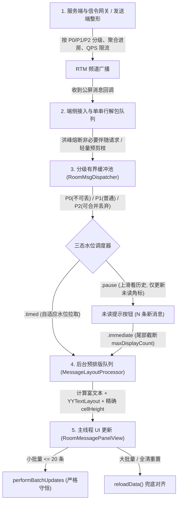

# 语音房防炸房与公屏消息面板性能优化实战

## 一、整体架构全景：端云协同五道防线

面对语聊房大礼物雨、活动抽奖、全员进房、恶意刷屏等“炸房”场景，核心设计原则是：**源头削峰、端侧保高优舍低优、计算彻底异步化、主线程只做轻量渲染与一致性兜底**。

### 核心度量目标
- **流畅度**：洪峰期主线程帧率 `FPS ≥ 55`，无明显掉帧或跟手卡顿；
- **可用性**：本人发言、礼物、红包、房主公告 **零丢失**，上滑看历史不被自动滚底抢占；
- **稳定性**：`UITableView` 零 `NSInternalInconsistencyException` 崩溃；
- **资源有界**：消息缓冲区与展示数据源内存有硬上限，不随炸房时长线性增长。

---

## 二、第一道防线：服务端削峰与无网关场景下的源头治理

### 1. 标准服务端与信令网关治理（有中心网关链路）
1. **消息优先级建模**
   - **P0（核心高优，不可丢）**：本人发出消息（强即时反馈）、礼物/盲盒、红包、房主公告、封禁/踢人/麦位关键管控信令、房间任务完成通知。
   - **P1（普通消息，可限流）**：普通公屏文本、`@` 消息、图片消息。
   - **P2（弱提示，可合并/丢弃）**：他人进房欢迎、点赞、关注提示、分享引导等。
2. **房间级 QPS 限流与有损降级**
   - 按房间维度配置令牌桶或滑动时间窗；当单房广播速率超过阈值（如 `30~50 条/s`）时，优先丢弃或随机采样 P2，保住 P0 和部分 P1。
3. **洪峰聚合广播（Coalescing）**
   - **进房聚合**：千人瞬间进房时，网关每 `500ms~1s` 合并下发一条聚合消息（如“张三等 28 人进入房间”），将 $O(N)$ 广播降为 $O(1)$。
   - **连击/点赞聚合**：同一用户短时连续点赞或小礼物连击，网关侧做时间窗计数折叠后再广播。
4. **发送端风控与防刷**
   - 单 UID 发言频率限制（如 1 秒 1 条）；命中脚本刷屏/风控名单时采用 **Shadow Ban（影子封禁）**：发送者本地看似发送成功，网关直接丢弃不向房间广播。
   - 新进房只拉取最近 `20~50` 条历史消息快照，防止进房即拉爆。

### 2. 补充：客户端直发 RTM（不经过自研业务网关）的源头治理方案
当普通聊天、进房、点赞等消息直接走第三方 RTM 频道广播而不经过业务服务端时，可采用以下组合手段补齐控制力：
1. **发送端本地整形（Sender-Side Shaping）**
   - **高频交互本地合批**：点赞等高频动作在发送端攒 `500ms~1s` 合并发 1 条带累计数的 RTM；普通发言增加发送冷却。
   - **自己消息本地直插**：本人发言/送礼成功后直接在本地构造 Model 走 P0 通道上屏（配合消息去重 ID 防止收到自己的 RTM 回调后重复插入）。
   - **大房进房静默策略**：房间在线人数超过阈值（如 `50~100` 人）时，端上停止自主广播进房 RTM，改由房间人数心跳或房主端聚合提示承载，从根源消灭进房风暴。
2. **远端热配置动态开关（RemoteConfig）**
   - 通过配置中心下发“抗炸房开关/档位”，运营大房或突发洪峰时可实时关闭非必要气泡渲染、下调最大展示条数（如 `200 → 100`）、开启进房消息静默丢弃。
3. **利用消息来源天然区分可信度与优先级**
   - 礼物/红包/任务等由业务服务端鉴权下发（外层带有服务端来源标识），天然与客户端直发消息隔离，接收端据此无条件保送 P0。

---

## 三、第二道防线：端侧接入、解包与伴随请求治理

### 1. 接入与解析队列设计（替代无界 `DispatchQueue.global().async`）
- **问题本质**：如果每来一条 RTM 就往 `DispatchQueue.global().async` 丢一个任务，炸房时上千个并发任务会瞬间榨干 GCD 线程池、引发剧烈线程上下文切换，且无法保证消息顺序。
- **最佳实践**：
  - 在消息分发接入层维护一个**专用串行解析队列**（`DispatchQueue(label: "com.app.voiceroom.msg.parse", qos: .userInitiated)`）。
  - **进入异步队列前拍平上下文**：主线程/上下文相关状态（如是否房主、房主 UID、是否自动上麦、房间形态、用户缓存信息等）必须在派发闭包前提取为不可变局部变量，**严禁在子线程闭包中直接访问业务上下文对象或非线程安全属性**。

### 2. 解析前快速剪枝（Fast Path Drop）
- 当下游缓冲区已经处于**高水位洪峰状态**时，在解析线程直接对非核心原始消息做轻量预判（或仅解码外层消息类型），直接丢弃他人进房、点赞等 P2 消息，省掉完整模型组装、文本正则与富文本生成开销。

### 3. 洪峰期“伴随网络请求”熔断
- **典型风险点**：
  - 房主侧他人进房拉取欢迎礼引导接口；
  - 关注提示消息实时查询双方关注关系；
  - 每条带气泡 ID 的消息阻塞等待远端气泡资源下载完成后再入队。
- **最佳实践**：
  1. **阻塞解耦**：所有消息**先入队上屏，不等待网络请求**。气泡资源先查内存/磁盘缓存，未命中则直接按默认气泡展示，后台静默异步下载供后续消息复用。
  2. **水位熔断**：当缓冲队列总积压量超过阈值（如 `> 50` 条）或单位时间进入量超标时，**直接跳过**进房引导接口、关系接口和远端气泡拉取。
  3. **请求去重与并发上限**：对同一 `uid` 或同一 `bubbleId` 的请求做短时去重（In-flight Coalescing），同时限制并发数。

---

## 四、第三道防线：端侧多级缓冲与自适应水位调度（核心）

将单一无界缓冲数组升级为 **`PriorityMessageBuffer`（分级有界缓冲池） + 水位自适应调度器**：

### 1. 分级有界缓冲池数据结构
| 队列层级 | 承载消息类型 | 容量上限 | 溢出淘汰策略 |
| :--- | :--- | :--- | :--- |
| **P0（高优队列）** | 本人消息、礼物/盲盒、红包、房主公告、任务完成、管控提示 | `100` 条 | 仅同级超限时丢弃最旧的非本人 P0，**绝不被 P1/P2 挤掉** |
| **P1（普通队列）** | 普通文本、`@` 消息、图片、互动分享 | `200` 条 | 环形覆盖 / 丢弃队头最旧消息（Keep-Latest） |
| **P2（低优/合并槽）** | 他人进房、点赞、常规关注/分享弱提示 | `20` 条 | 超限直接丢头留尾；连续同类消息（如进房）可本地合并为 1 条或只留最新几条 |

### 2. 三态状态机与水位自适应调度
调度器 `RoomMsgDispatcher` 维护 `.timed`、`.pause`、`.immediate` 三种模式，所有队列读写及状态切换统一收口在专用串行队列 `msgReadQueue`（或明确主线程与串行队列的单向边界）中：

1. **`.timed`（正常跟随模式）—— 按水位动态调速**
   每次定时器触发（基准间隔 `0.3s ~ 0.5s`）时，根据当前缓冲总积压量 `totalCount = P0.count + P1.count + P2.count` 走三档策略：
   - **低水位（`totalCount ≤ 20`）**：每次最多取出 **`5` 条**（严格按 `P0 → P1 → P2` 顺序），保证公屏均匀顺滑滚动的视觉体验。
   - **中水位（`20 < totalCount ≤ 100`）**：单批拉取量提升至 **`10 ~ 15` 条**，并**主动跳过或大幅压缩 P2 出队配额**，加快消化积压。
   - **高水位（`totalCount > 100`，炸房态）**：开启洪峰丢弃——保留全部 `P0`，直接裁剪丢弃 `P1` 队列头部、清空 `P2`，仅保留最新一屏（如尾部 `20~30` 条）送往下游，防止消费延迟雪崩。
2. **`.pause`（用户上滑看历史模式）**
   - 用户手指拖动列表（`scrollViewWillBeginDragging`）后立即切换为 `.pause`。
   - 定时器不再向 UI 推送消息，仅计算缓冲区增量总和更新底部未读按钮（`N 条新消息`，文案上限封顶如 `200` / `99+`）。
   - **关键细节**：暂停期间，缓冲池依然严格执行上述**容量上限与淘汰规则**，确保即使用户停在历史位置 10 分钟，后台队列内存也不会暴涨。
3. **`.immediate`（点击“N 条新消息”回到底部模式）**
   - 一次性消费积压消息，但**必须在出队时按 `maxDisplayCount`（如 200）做尾部截断**：只取各队列合并排序后的最新 `maxDisplayCount` 条，直接丢弃更早的积压，然后切回 `.timed` 并隐藏未读按钮。

### 3. 定时器与生命周期安全
- 推荐使用 `DispatchSourceTimer` 绑定在 `msgReadQueue` 上（不依赖 RunLoop），或将 `Timer` 统一调度在主线程 `.common` RunLoop 模式下（避免子线程创建 `Timer` 因无活跃 RunLoop 而静默不触发）。
- 回调全量使用 `[weak self]`，页面 `deinit` 时显式停止并置空定时器。

---

## 五、第四道防线：后台异步预排版与渲染性能优化

### 1. 后台预排版流水线（`MessageLayoutProcessor` 前置化）
- **优化前痛点**：如果在 `cellForRowAt` 里才做 `@` 正则解析、Emoji 替换、`YYTextLayout` 计算，配合 `UITableView.automaticDimension` 和 `SnapKit` 动态更新约束，每滚出一行都要在主线程触发“字符串解析 + CoreText 排版 + Auto Layout 约束求解”。
- **优化后流程**：
  1. 在 `RoomMsgDispatcher` 选出本批待上屏的 `messages` 后、切回 `DispatchQueue.main.async` **之前**（后台队列中），批量调用预排版接口。
  2. **参数显式传入**：将 `containerWidth`、`font`、`textColor`、`themeVersion` 等显式传入，**禁止在子线程读取可变的全局静态布局变量**。
  3. **计算并缓存 LayoutModel**：
     - 拼接完整的 `NSMutableAttributedString`（`@` 高亮、Emoji 附件、链接识别）；
     - 生成 `YYTextLayout` 并缓存（注意文本排版计算本身是线程安全的，只要不操作 `UIView` / `YYLabel` 实例）；
     - 结合头像、边距、气泡内边距直接算出**精确的 `cellHeight` 与关键子控件 `frame`**，存入 `model.layoutCache`。
  4. **主线程极简渲染**：
     - `tableView(_:heightForRowAt:)` 直接 $O(1)$ 返回 `model.layoutCache.cellHeight`（彻底移除 `automaticDimension` 与 `estimatedRowHeight` 估算误差带来的滚动跳动）；
     - `tableView(_:cellForRowAt:)` 直接将预生成的 `textLayout` 赋给 `YYLabel`（`label.textLayout = layout`），不触发任何约束重算和二次排版。

### 2. 渲染管线与 GPU / 内存深度优化
1. **消除 `cellForRowAt` 里的冗余对象分配**
   - 将 Cell 配置项列表在初始化阶段转为 `[MessageCellShowType: MessageCellItemProtocol]` 哈希字典，做到 $O(1)$ 查表，避免每次 `cellForRowAt` 重建几十个配置对象再线性查找。
   - 兜底 Cell 提前注册通用空白 Cell 并走 `dequeueReusableCell`，避免直接 `UITableViewCell()` 逃逸复用池。
2. **合并相似 Cell 复用标识**
   - 对结构高度一致的纯文本提示类消息合并复用池类型，提高复用命中率，减少常驻内存里的 Cell 实例总数。
3. **异步绘制与减少透明混合**
   - 复杂富文本 `YYLabel` 开启 `displaysAsynchronously = true`；
   - 头像圆角、等级徽章圆角背景通过 `CoreGraphics` 预裁剪并缓存圆角图，避免 `cornerRadius + masksToBounds` 触发离屏渲染；
   - 气泡背景 `.9` 图提前生成 `resizableImage` 缓存。
4. **动效生命周期管控**
   - 动态气泡、SVGA/WebP 动效在 `tableView` 快速拖动期间暂停，停止滚动后仅对 `visibleCells` 恢复播放；进入 `prepareForReuse()` 立即停播并置空重资源。
5. **顶部渐隐遮罩优化**
   - 面板顶部的渐变隐去效果在容器视图的 `layer.mask` 上使用静态 `CAGradientLayer`（仅在面板 `bounds` 变化时更新 frame），不在 `scrollViewDidScroll` 中逐 Cell 修改 `alpha`。

---

## 六、第五道防线：主线程 UI 更新、防崩溃与兜底策略

### 1. `performBatchUpdates` 崩溃根因与严谨范式
`NSInternalInconsistencyException` 的本质是：`performBatchUpdates` 执行完毕后，UIKit 会重新校验 `numberOfRowsInSection` 与“更新前行数 - 删除行数 + 插入行数”是否严格相等。

**必须守住的三条铁律**：
1. **更新计划与数据源变更同处一个同步主线程块**：先算完需要删除和插入的 `IndexPath`，再同步修改 `dataSource`，紧接着调 `deleteRows` / `insertRows`。
2. **严防边界条件差一错（`>` vs `>=`，`<` vs `<=`）**：
   - 当本批消息数 **`>= maxDisplayCount`** 时：若 `!dataSource.isEmpty`，先清空全部旧数据并 `deleteRows(0..<oldCount)`；再取 `Array(messages.suffix(maxDisplayCount))`，计算 `0..<appendMessages.count` 插入。
   - 当本批消息数 **`< maxDisplayCount`** 时：计算 `removeCount = dataSource.count + messages.count - maxDisplayCount`；当 `removeCount > 0 && removeCount <= dataSource.count` 时删除头部 `0..<removeCount`；插入阶段**严格按 `startIndex ..< startIndex + appendMessages.count` 计算 `insertIndexPaths`**，禁止用 `min(..., maxDisplayCount)` 截断索引却全量 `append` 数据。
3. **判空保护与关闭隐式动画**：
   - `deleteIndexPaths` 或 `insertIndexPaths` 为空时不调对应方法；
   - 用 `CATransaction.begin()` + `CATransaction.setDisableActions(true)` 关闭增删行动画，防止公屏闪烁；完成回调使用 `[weak self]` 避免视图销毁期强持有。

### 2. 大批量降级 `reloadData()` 兜底（工程极简主义）
不要用 `performBatchUpdates` 硬扛所有更新：
- 当满足以下任一条件时，**直接修改 `dataSource` 并调用 `tableView.reloadData()`**：
  1. 本批达到/超过上限全量重置（`messages.count >= maxDisplayCount`）；
  2. `.immediate` 模式点击未读按钮一次性回补大量消息；
  3. 单次增量删除或插入总行数超过阈值（如 `> 20` 行）。
- **原因**：`reloadData()` 本身开销极低（配合已缓存的预排版结果只需刷新当前可见的几个 Cell），且彻底免疫复杂增量 diff 计算引发的崩溃与动画错乱。

### 3. 滚动控制与局部更新协调
- **避免高频动画滚底相互打断**：常规低频期可用短动画 `scrollToBottom(true)`；高刷屏期（如连续多批或中/高水位）直接无动画 `setContentOffset` 吸底，且必须先校验 `!(tableView.isTracking || tableView.isDragging || tableView.isDecelerating)`。
- **旧消息原地刷新优化**：如关注回关、状态变更触发的旧消息原地更新，优先在主线程直接定位并局部 `reloadRows`（仅当切换了 `Cell` 类型才 `reloadData`），且保证与批量追加串行在主线程依次执行，不交错。

---

## 七、低端机降级与可观测性体系

### 1. 设备分档与实时帧率降级
- **启动静态分档**（按内存/机型）+ **运行时动态降级**（连续检测到主线程卡顿或 FPS < 45）：
  - 派发定时器间隔从 `0.3s~0.5s` 拉长至 `0.8s`；
  - 面板展示上限 `maxDisplayCount` 从 `200` 降为 `80~100`；
  - 关闭公屏内动效气泡、关闭滚底动画，退化为无动画纯文本+静态图渲染。

### 2. 核心监控指标埋点
- **流控健康度**：缓冲区水位峰值、各优先级（P0/P1/P2）主动丢弃/合并条数、伴随请求熔断触发次数；
- **性能指标**：后台预排版 P95 耗时、主线程 `cellForRowAt` 耗时、语聊房期间公屏滚动平均 FPS 与卡顿率；
- **稳定性指标**：`appendMessages` 降级 `reloadData` 触发次数、异常保护兜底上报（如果发现 `dataSource` 与期望不符主动拦截并重置 `reloadData()` 同时上报埋点，把潜在崩溃降维成可观测的兜底刷新）。

---

## 八、高频面试 Q&A 与回答要点

### Q1：为什么要做多级缓冲和定时批处理，不能收到一条 RTM 就直接刷新一条吗？
> **回答思路**：
> 1. **主线程与 UIKit 承压**：高并发下每秒几十上百条消息，直接逐条 `performBatchUpdates` 会触发高频主线程事务提交、布局计算和重绘，瞬间掉帧甚至卡死主线程。
> 2. **视觉体验**：逐条瞬时刷屏会导致肉眼根本看不清文字，而定时定量（如 300~500ms 拉 5 条）能把突刺流量平滑成匀速滚动。
> 3. **保底优先级**：没有分级缓冲，一旦队列满或限流，高价值的礼物/红包/本人消息就会被无意义的“XXX 进入房间”挤掉。

### Q2：如果语聊房的普通聊天、进房消息不经过业务服务端，直接走第三方 RTM 怎么防炸房？
> **回答思路**：
> 分三头发力：
> 1. **发送端整形**：点赞等高频动作本地合并发送；自己消息本地直插不绕 RTM；大房间人数超过阈值时停止自发进房广播，改用房间人数心跳或聚合提示。
> 2. **配置热降级**：借助远端配置中心下发抗炸房档位，活动大房直接关掉低优提示或缩小面板容量。
> 3. **接收端硬流控**：按消息来源（服务端下发 vs 端发）和业务类型在客户端自主划分 P0/P1/P2，建立有界优先队列，配合水位线调度与伴随网络请求熔断（进房礼引导、关系查询、气泡下载等洪峰期直接跳过），把防线筑在端侧渲染之前。

### Q3：`performBatchUpdates` 为什么经常报 `NSInternalInconsistencyException`？怎么彻底解决？
> **回答思路**：
> 1. **根因**：`performBatchUpdates` 内部会校验更新前后 `numberOfRows` 是否严格满足 `新 = 旧 - 删 + 插`。常见诱因有：多线程竞争修改 `dataSource`、边界判断 `>` / `>=` 或 `<` / `<=` 写反导致删除被跳过而插入仍按截断值算（或相反）、以及异步块执行时数据源已被其他刷新修改。
> 2. **解法**：
>    - **唯一写入口**：`dataSource` 严格只在主线程修改，且与 `deleteRows`/`insertRows` 在同一个同步闭包内计算并执行；
>    - **严格边界 & 按实际追加算索引**：`messages.count >= maxDisplayCount` 先判空清全表，增量插入索引直接由 `startIndex ..< startIndex + appendMessages.count` 计算；
>    - **大批量降级 `reloadData()`**：变更过大（如 > 20 行）或全清重置时直接 `reloadData()`，既快又零崩溃风险。

### Q4：后台异步预排版具体怎么落地？`YYTextLayout` 放到子线程有没有坑？
> **回答思路**：
> 1. **落地方式**：在定时出队后、切回主线程前，在串行排版队列完成 `NSAttributedString` 拼接、正则替换、`YYTextLayout(container:text:)` 生成，以及连带头像/边距在内的最终 `cellHeight` 计算，缓存在消息 Model 的布局对象中；主线程 `heightForRowAt` 直接 $O(1)$ 返回缓存高度，淘汰 `automaticDimension`。
> 2. **避坑点**：
>    - 子线程绝不访问 `UIView` / `UILabel` 及全局可变布局变量（如屏幕适配宽度要显式传参，绑定 `containerWidth` 与 `themeVersion`）；
>    - `YYTextLayout` 的创建和 `CoreGraphics` / `CoreText` 测量是线程安全的，但**富文本点击回调（`tapAction`）里绝不能强持有外部 Cell 或 ViewController**，统一通过 Cell 代理或事件转发处理；
>    - 注意横竖屏/主题切换时根据版本号按需失效重算缓存。

### Q5：用户上滑看历史消息时，怎么既不打断阅读又不撑爆内存？
> **回答思路**：
> 1. **交互隔离**：`scrollViewWillBeginDragging` 切到 `.pause` 模式停止上屏，自动滚底前检查 `!(isTracking || isDragging || isDecelerating)`；
> 2. **未读提示与上限封顶**：定时器仍在后台跑，但仅统计缓冲区增量并更新底部“N 条新消息”按钮（文案上限封顶如 200），缓冲区继续执行有界淘汰（保 P0、限 P1、弃 P2）；
> 3. **安全恢复**：用户点击未读按钮（`.immediate`）或手动滑回底部时，最多只从缓冲区尾部截取 `maxDisplayCount` 条，直接 `reloadData()` 对齐并滚底恢复 `.timed`。
